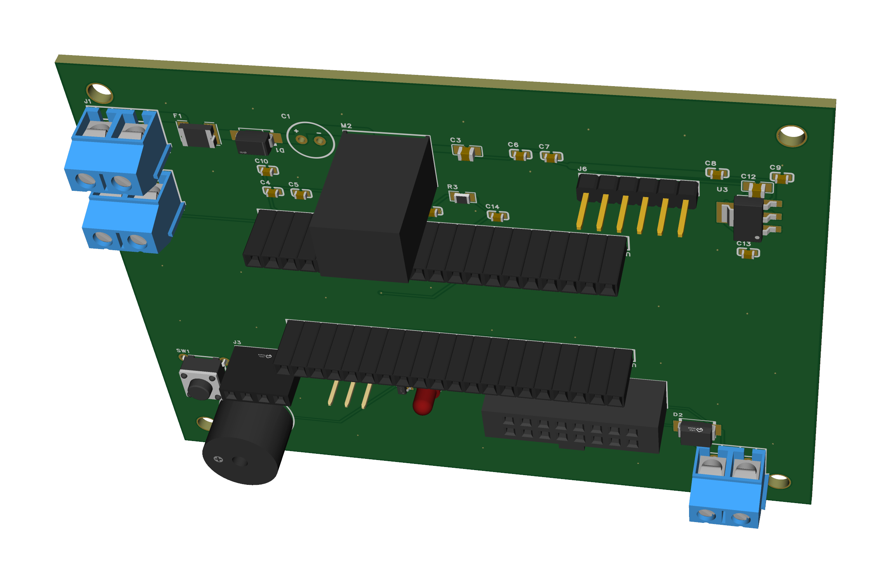
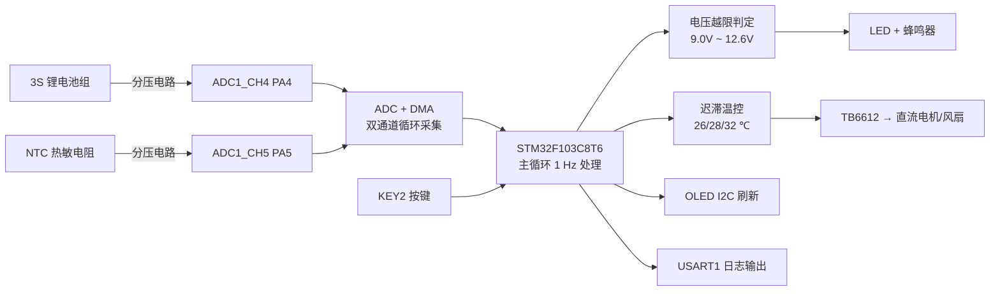
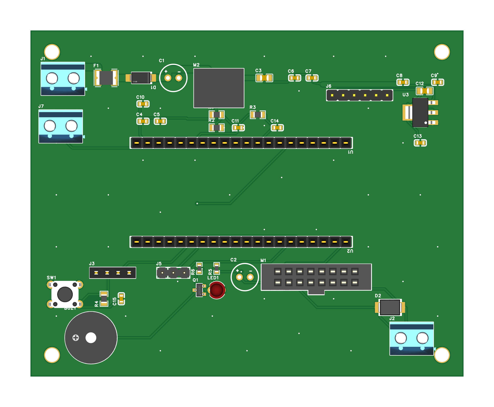
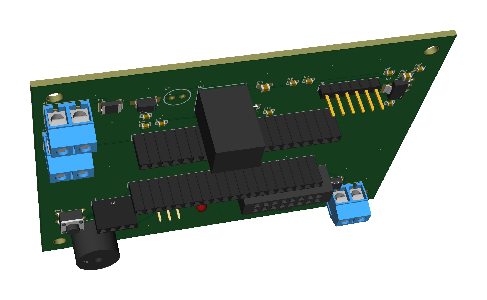
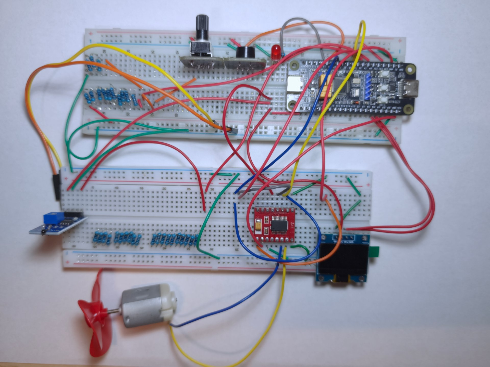
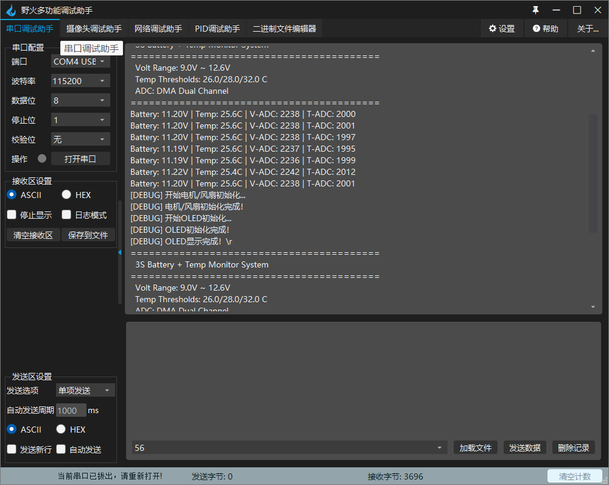

# 3S 锂电池电压监测与智能散热系统

> 基于 **STM32F103C8T6** 的三串锂电池组电压/温度实时监测系统，实现过压欠压声光报警、NTC 测温、风扇自动调速与 OLED 状态显示。

> [!WARNING]
> 本项目涉及 **3S 锂电池组（标称 11.1 V，满电 12.6 V）**，操作不当有起火与灼伤风险。**必须使用带保护板（BMS）的成品电池组**，禁止短路、反接与带电插拔。动手前请先读 [安全须知](#十三安全须知操作前必读)。


<p align="center">
  
</p>

<p align="center">
  <sub>PCB 版：100 × 80 mm 双层板，39 个元件，双面 GND 铺铜，DRC 0 违规 · 渲染由立创EDA 3D 预览导出</sub>
</p>

---

## 一、项目简介

本项目面向车载电子设备、无人机与机器人锂电池组的用电安全场景，独立完成从硬件选型、电路搭建、外设驱动到应用逻辑、测试验证与文档规范化的全过程。

系统以 STM32F103C8T6 为主控，通过 **ADC + DMA 双通道** 后台采集电池组总电压与 NTC 温度，实现：

- 电压越限（9.0 V ~ 12.6 V 之外）声光报警
- 温度三档迟滞调速，自动驱动风扇散热
- 0.96 寸 OLED 实时显示电压 / 温度 / 风扇档位 / 系统状态
- 串口 115200 输出调试数据，支持按键启停与温度模拟测试

**规模**：应用层自研代码约 900 行（`main.c` 551 行 / `oled.c` 275 行 / `motor.c` 85 行），完整工程含 STM32 HAL 驱动。

---

## 二、功能特性

### 2.1 核心功能

| 功能 | 实现方式 |
|------|----------|
| 实时电压监测 | ADC1_CH4（PA4）采集，分压电路适配 3.3 V 参考 |
| 实时温度监测 | ADC1_CH5（PA5）采集 NTC 热敏电阻（B 值法换算） |
| 数据采集 | ADC 扫描模式 + 连续转换 + DMA，CPU 零干预 |
| 过压欠压报警 | 越限时 LED 常亮 + 蜂鸣器间歇鸣叫（响 100 ms / 停 900 ms） |
| 风扇自动散热 | TB6612 驱动 + TIM3_CH1 PWM，三档迟滞调速 |
| OLED 显示 | I2C1（400 kHz），128×64 屏，四行状态信息 |
| 串口输出 | USART1 @115200 8N1，每秒打印一次，带发送完成确认 |
| 按键控制 | 短按切换温度模拟模式，长按 3 s 系统急停 |

### 2.2 电压报警逻辑

| 状态 | 电压范围 | LED | 蜂鸣器 |
|------|----------|-----|--------|
| 正常 | 9.0 V ~ 12.6 V | 灭 | 不响 |
| 过压 | > 12.6 V | 亮 | 间歇响 |
| 欠压 | < 9.0 V | 亮 | 间歇响 |

### 2.3 风扇温控逻辑（迟滞控制）

| 状态 | 温度条件 | 转速 | PWM 占空比 |
|------|----------|------|-----------|
| 低温停止 | < 26.0 ℃ | 停止 | 0 % |
| 中温低速 | > 28.0 ℃ | 低速 | 50 % |
| 高温高速 | > 32.0 ℃ | 高速 | 100 % |

> 采用 26 ℃ / 28 ℃ 双阈值迟滞设计，避免温度在阈值附近抖动时风扇频繁启停，延长电机寿命。

### 2.4 温度模拟测试模式

短按 KEY2 将温度强制置为 35 ℃，风扇立即进入高速档，用于**不加热源**快速验证温控链路：

- 模拟 ON：`Tmp: 35.0C`，风扇高速，OLED 显示 `Sys:Run [SIM]`
- 模拟 OFF：恢复正常采集与迟滞控制

---

## 三、系统架构



数据流：模拟量 → ADC/DMA 循环缓冲 → 主循环按 1 Hz 换算工程量 → 各执行器与显示刷新。采集与业务处理解耦，主循环不阻塞采样。

---

## 四、硬件设计

硬件分两阶段：**面包板验证版**（对应当前 v2.0 固件，功能已全部调通）与 **PCB 版**（v1.9 网表，已完成原理图 → 布线 → DRC → Gerber，待打样焊接）。

### 4.1 PCB 规格

| 项 | 参数 |
|------|------|
| 尺寸 / 层数 | **100 × 80 mm**，双层 |
| 板材 / 板厚 | FR-4，**1.6 mm** |
| 铜厚 | **1 oz**（35 μm） |
| 表面处理 / 阻焊 | 喷锡 / 绿油白字 |
| 元件数 | **39**（不含 4 个 M3 安装孔） |
| 走线 / 过孔 | 200 段（顶层 139 · 底层 61）/ 52 个 |
| 最小线宽 / 最小焊环 | 0.254 mm / 0.155 mm |
| 接地 | 双面 GND 铺铜 + 46 个缝合过孔 |
| DRC | **0 违规**（间距 0 · 未连接 0） |
| 安装 | 四角 M3 非金属化孔（3.2 mm），孔心距板边 5 mm |

电源主干线宽：`VBAT` / `VBAT_FUSE` / `VBAT_F` **1.5 mm**，`+5V` **1.0 mm**，信号线 0.254 mm。

保护与电源链：`J1` → 1.5 A 自恢复保险丝 → SS34 防反接 → `K7805-1000R3`（8–36 V 入 / 5 V 1 A 出，效率 93%）→ 5 V 主轨；WiFi 模块由独立的 `AMS1117-3.3` 供电，不与主 3.3 V 共用；电机输出端并联 `SMBJ15CA` 双向 TVS。

### 4.2 3D 渲染

<p align="center">
  
</p>

<p align="center">
  
  &nbsp;&nbsp;
  
</p>

正俯视图可对照丝印核对位号；透视图可见 K7805（立式 17.5 mm）与两排排母的高度关系。

### 4.3 PCB 版引脚分配

| 引脚 | 功能 | 模式 |
|------|------|------|
| PA4 | ADC1_CH4 电池电压采集 | 模拟输入 |
| PA5 | ADC1_CH5 温度采集（NTC 经 J7 端子外接） | 模拟输入 |
| PA6 | TIM3_CH1 电机 PWM | 复用推挽输出 |
| PB12 / PB13 | TB6612 AIN1 / AIN2 | 推挽输出 |
| PB14 | TB6612 STBY | 推挽输出 |
| PB0 | 蜂鸣器（经 S8050 三极管驱动） | 推挽输出 |
| PB1 | LED 指示灯 | 推挽输出 |
| PB6 / PB7 | I2C1 SCL / SDA（OLED，J3） | 复用开漏 |
| PA9 / PA10 | USART1 TX / RX（J5 调试口） | 复用推挽 / 浮空输入 |
| PB10 / PB11 | USART3 TX / RX（J6，接 WiFi 模块） | 复用推挽 / 浮空输入 |
| PC13 | 按键（板上 SW1 与核心板载 KEY2 并联） | 输入下拉 |

> **为什么和面包板版不一样**：面包板阶段直接用 PA0 / PA1 / PA2 / PA3，但这四个脚在野火核心板上分别接着**板载 KEY1 按键**和 **RGB 三色 LED**——按键按下会把分压点短接到地，LED 会分流并钳位 ADC 输入。核查过程见 [`20261021_引脚冲突核查_v1.0.md`](03_硬件设计/PCB设计/20261021_引脚冲突核查_v1.0.md)。
>
> 因此 **v2.0 固件的引脚配置不能直接跑在 PCB 上**，需把 ADC 通道从 CH0/CH1 改为 CH4/CH5、AIN1/AIN2/STBY 从 PA2/PA3/PA8 改到 PB12/PB13/PB14。**该适配已于 2026-10-23 完成**（v2.1.0，提交 `0f76d46`），本仓库当前固件可直接烧录到 PCB 版。第 7.3 节描述的是面包板接法，PCB 版的外部端子接法见 [7.4](#74-pcb-版外部接口)。

### 4.4 主要元件

| 类别 | 位号 | 说明 |
|------|------|------|
| 主控座 | U1 / U2 | 2.54 mm 1×20P 排母 ×2，拼成 40 脚插野火核心板 |
| 电源输入 | J1、F1、D1、M2、C1、C3 | KF301-2P 端子、1.5 A 保险丝、SS34 防反接、K7805-1000R3、100 µF 电解、22 µF 陶瓷 |
| WiFi 供电 | U3、C12、C13 | AMS1117-3.3 + 10 µF + 100 nF，与主 3.3 V 隔离 |
| 模拟采样 | R1、R2、R3、C11、C14、J7 | 51 k / 10 k 分压、10 k NTC 上拉、ADC 滤波、NTC 探头端子 |
| 电机驱动 | M1、C2、D2、J2 | TB6612 2×8P 双排母、100 µF 电解、SMBJ15CA、KF301-2P 端子 |
| 数字与外设 | J3、J5、J6、SW1、R4、C15、BUZ1、Q1、R6、LED1、R5 | OLED 排母、调试串口、WiFi 排针、按键与消抖、有源蜂鸣器与三极管驱动、LED 与限流 |
| 5 V 去耦 | C4 ~ C10 | 7 × 100 nF，分散布置在 +5V 各处 |
| 安装孔 | H1 ~ H4 | M3，3.2 mm，非金属化 |

完整 BOM（22 种料号，含 LCSC 编号与采购渠道）见 [`20261023_采购清单_v1.0.md`](03_硬件设计/20261023_采购清单_v1.0.md)，网络连接表与布局约束见 [`03_硬件设计/PCB设计/`](03_硬件设计/PCB设计/)。

### 4.5 面包板验证版（v2.0）

<p align="center">
  
</p>

<p align="center">
  <sub>面包板搭建的验证系统：STM32F103C8T6 核心板、0.96" OLED、TB6612 驱动模块与 130 电机风扇；电源由左侧线束外接，本图未入镜</sub>
</p>

| 引脚 | 功能 | 模式 |
|------|------|------|
| PA0 | ADC1_CH0 电池电压采集 | 模拟输入 |
| PA1 | ADC1_CH1 温度采集 | 模拟输入 |
| PA2 / PA3 | TB6612 AIN1 / AIN2 | 推挽输出 |
| PA6 | TIM3_CH1 电机 PWM | 复用推挽输出 |
| PA7 | TIM3_CH2 电机 PWM | 复用推挽输出 |
| PA8 | TB6612 STBY | 推挽输出 |
| PA9 / PA10 | USART1 TX / RX | 复用推挽 / 浮空输入 |
| PB0 / PB1 | 蜂鸣器 / LED | 推挽输出 |
| PB6 / PB7 | I2C1 SCL / SDA（OLED） | 复用开漏 |
| PC13 | KEY2 按键 | 输入下拉 |

> 上表是**面包板验证版**的接线记录，保留原样以备复现。PCB 版的引脚分配见 [4.3](#43-pcb-版引脚分配)，两者不可混用。

---

## 五、软件设计

### 5.1 模块划分

| 文件 | 职责 |
|------|------|
| `Core/Src/main.c` | 主循环、电压/温度换算、报警与温控逻辑、按键状态机 |
| `Core/Src/motor.c` | TB6612 驱动封装：初始化、正反转、调速、停止 |
| `Core/Src/oled.c` | OLED 初始化、字符/字符串显示、状态刷新 |
| `Core/Src/adc.c` `dma.c` `tim.c` `i2c.c` `usart.c` `gpio.c` | 外设初始化（初版由 CubeMX 生成，现为手工维护；`.ioc` 已更名为 `LYC1.ioc.bak`，不再回写 CubeMX） |
| `Core/Inc/*.h` | 模块接口与宏定义 |

### 5.2 关键技术点

**1. ADC + DMA 双通道循环采集**

```c
HAL_ADC_Start_DMA(&hadc1, (uint32_t*)adc_dma_buf, ADC_CHANNEL_NUM);
// adc_dma_buf[0] = IN4(PA4) 电池电压, adc_dma_buf[1] = IN5(PA5) NTC 温度
```

ADC1 配置为扫描 + 连续转换，DMA 循环搬运至内存，转换全程不占用 CPU。主循环每 20 个周期（约 1 s）读取一次缓冲区，天然完成软件滤波窗口。

**2. 电压换算与实测校准**

```c
const float divider_k = 6.21f;
total_volt = (adc_volt * adc_ref / 4095.0f) * divider_k;
```

分压系数并非理论计算值，而是用万用表实测基准电压后按 `新系数 = 旧系数 × (实测电压 / 显示电压)` 反解校准，最终误差收敛到 **±0.02 V**。

**3. 迟滞温控**

```c
#define TEMP_FAN_ON    28.0f   // 启动风扇
#define TEMP_FAN_OFF   26.0f   // 停止风扇
#define TEMP_FAN_HIGH  32.0f   // 高速风扇
```

温度上升穿过 28 ℃ 才启动，下降穿过 26 ℃ 才停止，中间 2 ℃ 死区消除反复启停。

**4. 串口发送完成确认**

`UART_WaitTxComplete()` 在系统停止前轮询 TC 标志（带 200 ms 超时），保证「系统已经停止」这类关键日志不会因关中断/停止流程而丢失。

**5. 按键状态机**

单键实现两种语义：短按切模式、长按 3 s 急停。采用 10 次计数软件消抖 + `key2_long_triggered` 一次性标志，保证长按只触发一次、释放时不误判为短按。

---

## 六、目录结构

```
Project/
├── 01_文档资料/              # 项目管理、问题跟踪、代码规范
│   ├── 01_项目管理/          # 项目计划（功能实现、目录与文档治理）
│   ├── 02_问题跟踪/          # 问题记录、调试日志与各问题的修复计划
│   └── 03_开发指南/          # 20260612_代码风格规范_v1.0.md
├── 02_固件代码/              # 固件源码
│   └── STM32F103C8T6/LYC1/   # Keil 工程（Core + Drivers + MDK-ARM + LYC1.ioc.bak）
├── 03_硬件设计/              # 采购清单、PCB 设计输入、引脚冲突核查
├── 04_测试验证/              # 测试用例与测试脚本（C / Python）
├── 05_交付产物/              # 固件、Gerber、原理图、渲染图与演示素材
│   ├── 固件/                 # LYC1_v2.0.hex
│   ├── Gerber/               # 下单版（100×80 双层）与完整导出备份
│   ├── 原理图/               # 四页原理图 PDF
│   ├── PCB效果图/            # 3D 渲染图（等轴测 / 正俯视 / 透视）
│   └── 演示素材/             # 实物图、串口截图、演示视频
├── CHANGELOG.md              # 版本变更日志
├── LICENSE                   # 自写代码 MIT / 硬件设计 CC BY-SA 4.0
├── THIRD-PARTY-NOTICES.md    # 第三方组件许可与商标声明
└── README.md
```

---

## 七、快速开始

### 7.1 编译

1. 安装 **Keil MDK 5** 及 `Keil.STM32F1xx_DFP` 器件支持包
2. 打开工程：`02_固件代码/STM32F103C8T6/LYC1/MDK-ARM/LYC1.uvprojx`
3. `F7` 编译，`F8` 下载（ST-Link / DAP-Link 均可）

工程初版由 STM32CubeMX 生成，外设初始化现已改为手工维护。原始配置 `LYC1.ioc` 已归档为 `LYC1.ioc.bak`（仅单通道 ADC，缺 I2C1 / TIM3 / DMA / 按键配置，与当前代码已脱节），**请勿用 CubeMX 重新生成代码**，否则会覆盖现有驱动。

### 7.2 直接烧录

不编译也验证功能：面包板版烧录 [`05_交付产物/固件/LYC1_v2.0.hex`](05_交付产物/固件/LYC1_v2.0.hex)（引脚 PA0 / PA1 / PA2 / PA3 / PA8，接法见 [7.3](#73-接线要点面包板验证版)）。

> **该 hex 为面包板引脚映射，不能直接烧到 PCB 版**。PCB 版需按 [4.3](#43-pcb-版引脚分配) 的引脚用 Keil 重新编译（本仓库固件源码已适配）。

### 7.3 接线要点（面包板验证版）

> **本节对应 v2.0 固件与面包板接法。** PCB 版的引脚已改为 PA4 / PA5（ADC）与 PB12 / PB13 / PB14（电机），见 [4.3 PCB 版引脚分配](#43-pcb-版引脚分配)。PCB 打样回来后**不需要按本节飞线**，要接的外部端子见 [7.4 PCB 版外部接口](#74-pcb-版外部接口)。

1. 电池正极 → 分压电阻 → PA0（**分压后必须 ≤ 3.3 V**）
2. NTC 分压节点 → PA1
3. OLED：PB6 = SCL，PB7 = SDA
4. TB6612：AIN1 = PA2，AIN2 = PA3，STBY = PA8，PWMA = PA6
5. **STM32、TB6612、电池三者必须共地**

### 7.4 PCB 版外部接口

板上连线已全部做完，打样焊好后只剩 **6 个端子 + 两个排母插核心板**。脚位按 v1.9 网表定稿：

| 端子 | 1 脚 | 2 脚 | 3 脚 | 4 脚 | 5 脚 | 6 脚 |
|------|------|------|------|------|------|------|
| **J1** 电池输入（KF301-2P） | `VBAT` 电池正极 | `GND` 电池负极 | — | — | — | — |
| **J2** 电机输出（KF301-2P） | `AO1` | `AO2` | — | — | — | — |
| **J7** NTC 探头（KF301-2P） | `PA5` | `GND` | — | — | — | — |
| **J3** OLED（1×4P 排母） | `GND` | `+3V3` | `SCL`（PB6） | `SDA`（PB7） | — | — |
| **J5** 调试串口（1×3P 排针） | `GND` | `TX`（PA9） | `RX`（PA10） | — | — | — |
| **J6** WiFi（1×6P 排针） | `+3V3_WIFI` | `GND` | `USART3_TX`（PB10） | `USART3_RX`（PB11） | `WIFI_EN` | `WIFI_IO0` |

**六条接线注意事项**：

1. **J6 是交叉接法**：`J6-3`（PB10，本机 TX）接 NodeMCU 的 **RX**，`J6-4`（PB11）接 NodeMCU 的 **TX**。接反了收不到数据，不会烧。
2. **NodeMCU 供电接它自己的 3V3 脚，不要接 VIN**：`J6-1` 已经是 AMS1117 出来的稳定 3.3 V，再经 NodeMCU 板载 LDO 会多一级压降。`WIFI_EN` / `WIFI_IO0` 板上**故意不加上拉**（NodeMCU 底板自带 10 kΩ + 按键），不用外接。
3. **J7 两脚不能接反**：1 脚是 `PA5`（经 R3 上拉到 3.3 V），2 脚是 `GND`。接反等于把 3.3 V 直接短到地。
4. **J3 是 GND-VCC-SCL-SDA 顺序**，与市面上大多数 0.96" OLED 模块的引脚顺序一致。但插反就是电源反接，**会烧模块**，插之前对一眼丝印。
5. **核心板插装**：U1（靠电池端子那排）与 U2（靠 3V3 那排）分别对应核心板的两条 20 脚排针，**按板上丝印的 1 脚标记对齐**，插上后目视确认 40 个脚全部落进排母、没有整体错位一格（错一格是最常见的事故）。插之前先拿核心板实物对一眼 1 脚丝印的位置。
6. **J5 接外接 USB-TTL 时，必须拔掉核心板上的 CH340 跳线帽**，否则两个 TXD 对打，串口助手收到乱码。只用核心板 Type-C 时不拔跳线帽、J5 空着就行。

> 只插核心板 Type-C、不接电池时，USB 的 5 V 会经核心板的 5V 引脚反灌到 `+5V` 网络，整板逻辑部分能工作，但**带不动电机**（USB 限流 500 mA），且长期反灌对 K7805 不友好——调试够用，别当正常工作方式。

### 7.5 串口输出

串口助手配置 `115200 8N1`，上电后输出：

```
=========================================
  3S Battery + Temp Monitor System
=========================================
  Volt Range: 9.0V ~ 12.6V
  Temp Thresholds: 26.0/28.0/32.0 C
  ADC: DMA Dual Channel
=========================================
Battery: 12.35V | Temp: 28.5C | V-ADC: 3245 | T-ADC: 2048
[Fan] Low Speed 50%
[Fan] High Speed 100%
[测试] 温度模拟模式: ON (35C)
[系统] 系统已经停止
```

串口实际输出截图：



完整运行录像见 [项目2.0演示视频.mp4](05_交付产物/演示素材/项目2.0演示视频.mp4)（5.9 MB）。

### 7.6 无硬件预览（可选）

没有硬件时，`04_测试验证/测试脚本/` 下两个脚本可以预览最终效果：

| 脚本 | 作用 | 默认端口 |
|---|---|---|
| `web_preview_server.py` | 起一个返回模拟数据的网页服务，手机浏览器可直接看 | 8080 |
| `mock_esp_server.py` | 模拟 ESP8266 的 `/api/data` 接口，供页面联调 | 8888 |

> 两个脚本都监听 `0.0.0.0` 以便手机访问，**无鉴权机制**，只返回模拟数据、不接受写入。请仅在可信网络（自家路由器）下使用，用完 `Ctrl+C` 关闭。

---

## 八、测试与验证

| 测试项 | 方法 | 结果 |
|--------|------|------|
| 电压采集精度 | 万用表实测值对比串口输出 | 误差 ≤ 0.02 V |
| 按键识别 | 短按 / 长按组合操作 | 短按切换温度模拟模式、长按 3 s 停机，均正常响应 |

> **温度与风扇相关功能未做实测，仅做逻辑验证。**
> 风扇与 OLED 的联动是在**温度模拟模式**下确认的（长按 KEY2 进入，固件内固定 35 ℃，见 [2.4](#24-温度模拟测试模式)），**并非实测 NTC 温度链路**。因此本项目**不声明测温范围与测温精度**；三档迟滞控制（28 ℃ 启动 / 26 ℃ 停止 / 32 ℃ 转高速）为固件逻辑，已通过代码审查确认，**未做阈值附近的实物复核**。

### 8.1 测试条件

上表两项结论的复现条件，以及温度 / 风扇相关固件逻辑的全部参数，均可在 `02_固件代码/STM32F103C8T6/LYC1/Core/Src/main.c` 中逐项核对：

| 项 | 值 | 代码依据 |
|---|---|---|
| ADC 分辨率 / 参考电压 | 12 bit（满量程 4095）/ 3.3 V | `adc_ref` 与 `4095.0f` |
| 采样周期 | 1 Hz（主循环 50 ms × 20 次） | `adc_sample_cnt >= 20` |
| 电池分压系数 | **6.21**（理论 6.10；6.21 为面包板阶段实测校准值，**待新板复校**） | `divider_k` |
| NTC 参数 | 10 kΩ 上拉、R0 = 10 kΩ、B25/50 = 3950 | `NTC_R_PULLUP` / `NTC_R0` / `NTC_B` |
| 温度换算方法 | NTC 分压 → B 值法解析计算（非查表） | `logf(r_ntc / NTC_R0) / NTC_B` 段 |
| 风扇阈值 / 回差 | 28 ℃ 启动、26 ℃ 停止（回差 2 ℃）、32 ℃ 转高速 | `TEMP_FAN_ON` / `TEMP_FAN_OFF` / `TEMP_FAN_HIGH` |
| 长按判定 | 60 × 50 ms = 3 s | `key2_long_press_cnt < 60` |
| 按键消抖 | 10 × 50 ms = 500 ms | `key2_debounce >= 10` |

上表 6 项均为**实物手工测试**（面包板 + 万用表 + 串口助手），非自动化执行。

[`04_测试验证/`](04_测试验证/) 目录内容：

| 子目录 | 文件 | 性质 |
|---|---|---|
| `测试用例/` | 按键控制 8 条用例（TC-001 ~ TC-008），含 2.9 s / 3.1 s 边界值 | 手工执行的用例记录 |
| `测试脚本/` | `test_voltage.py`、`uart_send_verify.py` | **纯软件仿真**：把固件的电压换算公式与串口 TC 时序逻辑移植到 PC，用 mock 复现，不连接硬件 |
| `测试脚本/` | `web_preview_server.py`、`mock_esp_server.py` | 网页预览与接口 mock，见 [7.6](#76-无硬件预览可选) |

> 仿真脚本用于**不接硬件时验证算法与时序逻辑自洽**，不能替代硬件实测；上表结论均来自硬件实测。

### 8.2 测试范围与局限

本节为**个人样机的功能验证**，用于确认硬件设计与固件逻辑符合预期，**不是型式试验，也不是第三方检测报告**。

- 结论均来自面包板阶段的实物观测，**未按 GB/T 2423 系列做高低温、温度循环、振动、湿热等环境试验**
- **分压系数 6.21 属旧配置校准结果，当前配置未复校**：该值是在 ADC 仍在 PA0、且 PA0 被板载 KEY1 并联的状态下标定得出的（见 [`20261021_引脚冲突修订操作单_v1.0.md`](01_文档资料/02_问题跟踪/20261021_引脚冲突修订操作单_v1.0.md) 第五节）。ADC 迁至 PA4 后分压网络变干净，且 PCB 版换用 1% 电阻（理论 6.10），**尚未按实测重新标定**。因此「误差 ≤ 0.02 V」为旧配置下的校准结果，**不代表当前代码在新板上的精度**；新板焊接后须按同一方法复校。
- **NTC 温度链路在实装前已校准，但未留存比对记录**：探头接入电路前已做过标定，因此**不存在已知的温度偏差**；但仓库内未保留恒温源与标准温度计的对比数据，故**不声明测温范围与测温精度**。风扇与 OLED 的联动在温度模拟模式下确认（固件内固定 35 ℃）
- **未做迟滞阈值的实测复核**：28 / 26 / 32 ℃ 三个阈值只经代码审查，未在真实温度变化下观测风扇动作
- **仪器型号与测试轮次未逐项归档**：精度项为万用表读数与串口打印值对比，未做多表交叉比对与测量不确定度分析
- **未做长时间稳定性验证**：项目通电运行时长以功能确认为限，未做连续数小时的丢帧统计；串口只验证了 1 Hz 数据输出的解析正确性，无协议层计数器
- 未做 EMC 预测试（辐射骚扰 / 传导骚扰），板级仅按经验做了滤波、去耦与 TVS 防护

> 若需进入商品化或送检流程，须按目标标准补齐仪器校准记录、测试轮次与判定准则，并由具备资质的实验室出具报告。详见 [十三、安全须知](#十三安全须知操作前必读) 第 7 条。

问题排查过程见 [`01_文档资料/02_问题跟踪/`](01_文档资料/02_问题跟踪/)。

---

## 九、开发中踩过的坑

| 问题 | 根因 | 解决 |
|------|------|------|
| 电机完全不转，折腾两天 | 面包板左右电源轨不连通，STM32 / TB6612 / 电池**未真正共地**，逻辑电平参考不一致 | 用杜邦线直接跨接三个 GND 点，不依赖电源轨 |
| 系统停止时串口日志丢失 | 停止流程早于 UART 移位寄存器发送完成 | 新增 `UART_WaitTxComplete()` 轮询 TC 标志 |
| 第二次长按不打印停止信息 | `key2_long_triggered` 只在 `system_running == 1` 时置位，系统已停止时长按标志仍为 0，释放被误判为短按 | 将标志置位移出条件判断，达到长按时长即置位 |
| 电压读数偏差大 | 分压系数按理论值取 5.15，未考虑电阻精度与线损 | 以万用表实测值反解，校准为 6.21 |
| 下载后 LED 不亮、串口无输出 | GPIO 上拉配置缺失；局部变量定义在 `while(1)` 内层，老版本 Keil 处理异常 | 修正 GPIO 模式，变量提升到循环外 |

---

## 十、版本记录

| 版本 | 日期 | 说明 |
|------|------|------|
| v1.0.0 | 2026-06-01 | 项目初始化，基础 GPIO 与串口调试 |
| v2.0.0 | 2026-06-04 | 电压/温度采集、风扇温控、OLED 显示、DMA 双通道、按键启停 |
| v2.1.0 | 2026-10-23 | 适配 PCB 版引脚（ADC → CH4/CH5、电机 → PB12/PB13/PB14）；NTC 改 B 值法换算并新增探头开路/短路判定；禁用电机反转；`.ioc` 归档为 `LYC1.ioc.bak` |

详细变更见 [CHANGELOG.md](CHANGELOG.md)。

---

## 十一、许可

本项目**自写部分**（`01_文档资料/`、`02_固件代码/STM32F103C8T6/LYC1/Core/`、`04_测试验证/`、`05_交付产物/` 中的自制文件）采用 [MIT License](LICENSE) 开源。

**硬件设计文件**（`03_硬件设计/`、`05_交付产物/原理图/`、`05_交付产物/Gerber/`）采用 [CC BY-SA 4.0](https://creativecommons.org/licenses/by-sa/4.0/deed.zh) 授权：可自由复制、修改、商用，需署名并以相同方式共享。

**第三方组件**版权归原所有者，遵循各自许可证，详见 [THIRD-PARTY-NOTICES.md](THIRD-PARTY-NOTICES.md)：

| 路径 | 组件 | 许可证 | 版权所有者 |
|---|---|---|---|
| `Drivers/STM32F1xx_HAL_Driver/` | STM32F1 HAL Driver | BSD-3-Clause | STMicroelectronics |
| `Drivers/CMSIS/` | ARM CMSIS Core | Apache-2.0 | Arm Limited |
| `Drivers/CMSIS/Device/ST/STM32F1xx/` | STM32F1 Device 支持包 | Apache-2.0 | STMicroelectronics |
| `MDK-ARM/startup_stm32f103xb.s` | 启动文件 | BSD-3-Clause | STMicroelectronics |

README 中出现的 STM32、STM32F103C8T6 为 STMicroelectronics International N.V. 商标；野火小智、江科大、金升阳 Mornsun、Littelfuse、嘉立创、立创EDA 等为各自所有者商标。本项目与上述公司无隶属、合作或背书关系。

---

## 十二、注意事项

1. **电压限制**：STM32 GPIO 输入不得超过 3.3 V，测 12.6 V 电池组必须使用分压电路
2. **分压校准**：`divider_k = 6.21` 是上一版面包板实测值，更换电阻或走线后需重新校准（`新系数 = 当前系数 × 实测电压 ÷ 显示电压`）
3. **温度标定**：NTC 已采用 B 值法换算（`R3 = 10 kΩ` 上拉、`R0 = 10 kΩ`、`B = 3950`、`T0 = 298.15 K`），常温段误差约 ±1 ℃，更高精度可改查表法。**探头必须是 B = 3950**，买成 3435 会导致全量程偏移
4. **共地检查**：接线后先用万用表确认各模块 GND 导通，再上电
5. **探头故障识别**：J7 未插探头或探头断线时，`PA5` 被 R3 上拉到接近 3.3 V，固件判定为开路，OLED 显示 `NTC--`、串口打印 `NTC-- (open)`，风扇强制停转；探头短路到地则判定为 `short`。两种情况都不会被误当成低温而掩盖故障

---

## 十三、安全须知（操作前必读）

本项目涉及 **3S 锂电池组（标称 11.1 V，满电 12.6 V）**，能量密度较高，操作不当有起火与灼伤风险。

1. **必须使用带保护板（BMS）的成品电池组**，不要用裸电芯自行串接。板上 F1（1.5 A 自恢复保险丝）与 D2（SMBJ15CA TVS）只应对板内异常，**不能替代电池保护板**。
2. **接线顺序**：先接 GND，再接 VBAT；拆线顺序相反。接入前用万用表确认极性与端子丝印一致。
3. **禁止带电插拔**电池端子、电机端子、核心板。
4. **首次上电先不接电机**：用万用表确认 `+5V`、`+3V3` 对地无短路，再插核心板。
5. **禁止短路、挤压、穿刺、拆解电池**。鼓包、漏液、跌落的电池立即停用并按规定回收。
6. **不得用于安全关键场合**（车载量产、医疗、消防、BMS 主保护等）。本项目是学习与验证样机，**不是经过认证的产品设计**。
7. 本设计**未经过任何安规、EMC、环保认证**。如需商品化，须按目标市场完成 CE / FCC / CCC 等认证，并满足 RoHS 2011/65/EU、GB/T 26572 等有害物质限制要求。

依据 [MIT License](LICENSE)，作者不对因使用本项目产生的任何直接或间接损失承担责任。
